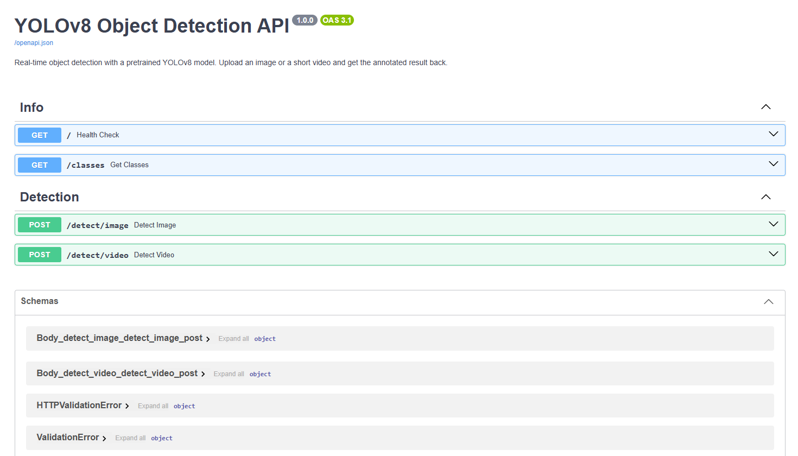
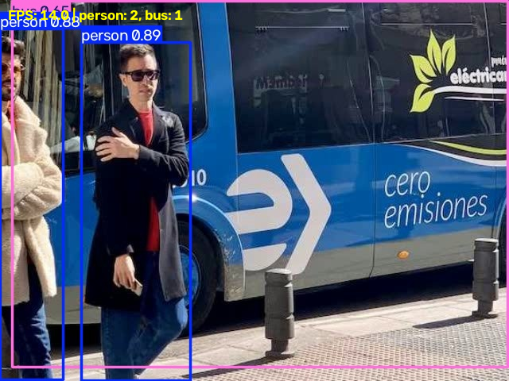

# Real-Time Object Detection with YOLOv8

A FastAPI service that runs a **pretrained YOLOv8** model on images and short videos and returns the annotated result, plus a local **webcam client** that streams frames to the API for live detection.

No training or fine-tuning is involved; the project uses the pretrained `yolov8n.pt` weights.

## About YOLOv8 and the COCO classes

YOLO ("You Only Look Once") is a single-stage object detector: one forward pass of the network predicts every object in the image at once, which makes it fast enough for real-time use. YOLOv8 by Ultralytics comes in several sizes (n, s, m, l, x); this project uses **YOLOv8n (nano)**, the smallest and fastest variant, which runs comfortably on a CPU.

For every detected object the model returns three things:

| Output | Field in `results[0].boxes` | Meaning |
|---|---|---|
| Bounding box | `boxes.xyxy` | `[xmin, ymin, xmax, ymax]` in pixels |
| Class | `boxes.cls` | Class ID, mapped to a name via `model.names` |
| Confidence | `boxes.conf` | Score between 0 and 1 |

### Connection to Class 21

This project applies the ideas from the Class 21 notebook directly:

- **Detector output.** Exactly as in the notebook's "Inspect YOLO's Output" cell, every detection is a box (`xyxy`), a class (`cls` → `model.names`) and a confidence (`conf`). The API uses `results[0].boxes.cls` to build the per-class counts in the `X-Detections` header, and `results[0].plot()` to draw the boxes.
- **Confidence threshold.** The notebook kept detections with `conf=0.50`; here the threshold is the `confidence` query parameter (default `0.4`).
- **IoU and NMS.** YOLO often predicts several overlapping boxes for one object. Ultralytics runs Non-Maximum Suppression internally (IoU threshold 0.7 by default), keeping the highest-confidence box and removing boxes that overlap it strongly, the same procedure the notebook demonstrated with `torchvision.ops.nms`.
- **One-stage vs two-stage.** YOLO goes `image → detections` in a single pass, whereas Faster R-CNN goes `image → region proposals → classify/refine`. YOLO's single pass is what makes the live webcam client practical.
- **Same test image.** `samples/test_image.jpg` is the Ultralytics `bus.jpg` image used in class, and `samples/test_video.mp4` is a short pan across it, so both should produce `person` and `bus` detections.

The pretrained weights were trained on the **COCO dataset**, so the model recognises **80 everyday object classes** such as `person`, `bicycle`, `car`, `dog`, `cat`, `bottle`, `cup`, `laptop`, `cell phone` and `chair`. The full list is available from `GET /classes`.

## Project structure

```
yolo-object-detection/
|-- main.py              # FastAPI app (model loaded once at startup)
|-- webcam.py            # Local live webcam client
|-- test_api.py          # Automated API tests
|-- requirements.txt
|-- README.md
|-- samples/
|   |-- test_image.jpg
|   `-- test_video.mp4
`-- screenshots/
    |-- swagger.png
    |-- image_detection.png
    `-- webcam_detection.png
```

## API endpoints

| Method | Endpoint | Description |
|---|---|---|
| GET | `/` | Health check. Returns status and model information. |
| GET | `/classes` | Returns the 80 COCO class names of the pretrained model. |
| POST | `/detect/image` | Upload an image; returns the annotated JPEG. Per-class counts are in the `X-Detections` response header. |
| POST | `/detect/video` | Upload a short video; processes it frame by frame and returns the annotated MP4. |

### Query parameters (both detection endpoints)

| Parameter | Type | Default | Description |
|---|---|---|---|
| `confidence` | float (0–1) | `0.4` | Minimum confidence score. Detections below this are discarded. Raise it for fewer, more certain boxes; lower it to catch more objects at the cost of false positives. |
| `classes` | string | `""` | Comma-separated class names, e.g. `person,car`. Empty means detect all 80 classes. Names are converted to IDs using `model.names`; an unknown name returns HTTP 400. |

### Responses

`/detect/image` returns `image/jpeg` with a header like:

```
X-Detections: {"person": 4, "bus": 1}
```

`/detect/video` returns `video/mp4` (download name `detected.mp4`) with a summary header:

```
X-Detections: {"frames": 60, "max_per_frame": {"person": 4, "bus": 1}}
```

### Error handling

| Case | Status |
|---|---|
| Data that is not a decodable image | 400 |
| Video that cannot be opened / has no frames / unsupported extension | 400 |
| Unknown class name in `classes` | 400 |
| `confidence` outside 0–1 | 422 |
| Image over 10 MB or video over 100 MB | 413 |

## Installation

Requires Python 3.9+.

```bash
git clone <your-repo-url>
cd yolo-object-detection

python -m venv .venv
# Windows: .venv\Scripts\activate
source .venv/bin/activate

pip install -r requirements.txt
```

The `yolov8n.pt` weights (~6 MB) download automatically the first time the server starts.

## Start the FastAPI server

```bash
fastapi dev main.py
```

- API: http://localhost:8000
- Swagger UI: http://localhost:8000/docs

(Alternative: `uvicorn main:app --reload`.)

## Testing from Swagger UI

1. Open http://localhost:8000/docs.
2. Expand **GET /** → **Try it out** → **Execute**. You should see `"status": "ok"`.
3. Expand **POST /detect/image** → **Try it out**.
4. Choose `samples/test_image.jpg` for `file`, optionally set `confidence` and `classes` (e.g. `person`).
5. Click **Execute**. The annotated image appears in the response body and the counts appear in the `x-detections` response header.
6. Repeat with **POST /detect/video** and `samples/test_video.mp4`; Swagger shows a download link for the annotated video.

## Running the automated tests

Start the server in one terminal, then in another:

```bash
python test_api.py
# or
pytest test_api.py -v
```

The tests cover: health check, 80 COCO classes, JPEG response for image detection, parsable `X-Detections` header, `classes=person` filter, HTTP 400 for invalid images (and unknown class names), and HTTP 200 video response for `/detect/video`.

Expected output:

```
PASS  test_health_check
PASS  test_classes
PASS  test_detect_image
PASS  test_detection_counts
PASS  test_class_filter
PASS  test_invalid_image
PASS  test_unknown_class
PASS  test_detect_video

8/8 tests passed
```

## Running the webcam client

With the API running, open a second terminal:

```bash
python webcam.py
```

Options:

```bash
python webcam.py --confidence 0.5 --classes person,cell\ phone --camera 0
```

- Press **q** to quit.
- Press **s** to save the current annotated frame to `screenshots/webcam_detection.png`.

The window shows the annotated frame, the current FPS, and the per-class counts. If the API is unreachable the raw camera frame is shown with "API offline".

## Screenshots

### Swagger UI


### Image detection


### Webcam detection

