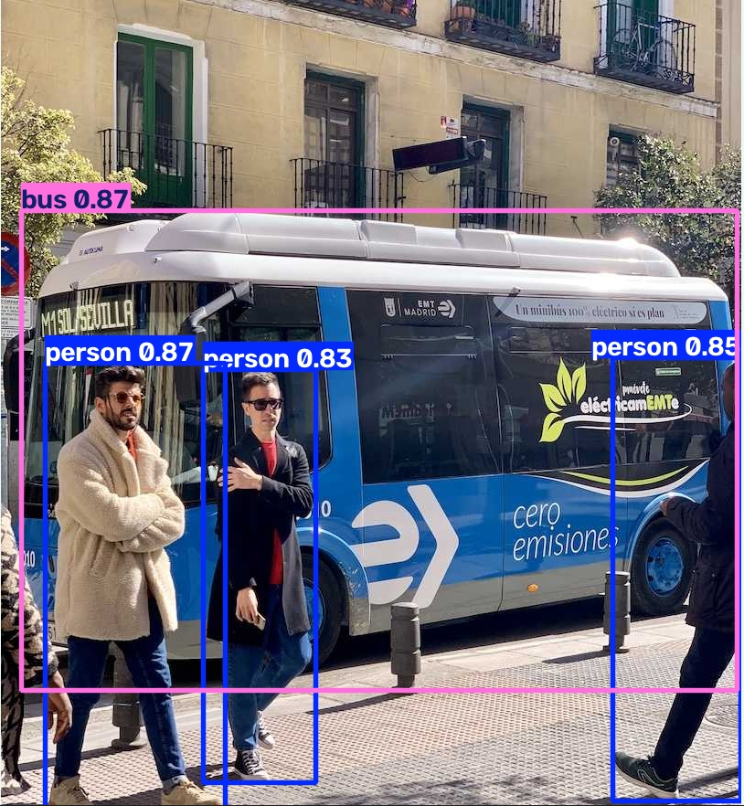

# Project 06 Submission – Real-Time Object Detection with YOLOv8

**Student:** <Md. Farid Hasan>

## 1. GitHub repository
<https://github.com/<faridhasan2020>/yolo-object-detection>

## 2. Implemented API endpoints

| Method | Endpoint | Description |
|---|---|---|
| GET | `/` | Health check – status and model information |
| GET | `/classes` | 80 COCO class names of the pretrained model |
| POST | `/detect/image` | Annotated JPEG + `X-Detections` counts header |
| POST | `/detect/video` | Annotated MP4, processed frame by frame |

Both detection endpoints accept `confidence` (float, default 0.4) and `classes` (comma-separated names, default empty = all).

## 3. Object detection result

## 4. Test results
`python test_api.py` passes: **8/8 tests passed**
(health check, classes, image JPEG, X-Detections JSON, class filter, invalid image → 400, unknown class → 400, video detection).

## 5. Webcam client
`webcam.py` was tested locally against the running API; see `screenshots/webcam_detection.png`.
